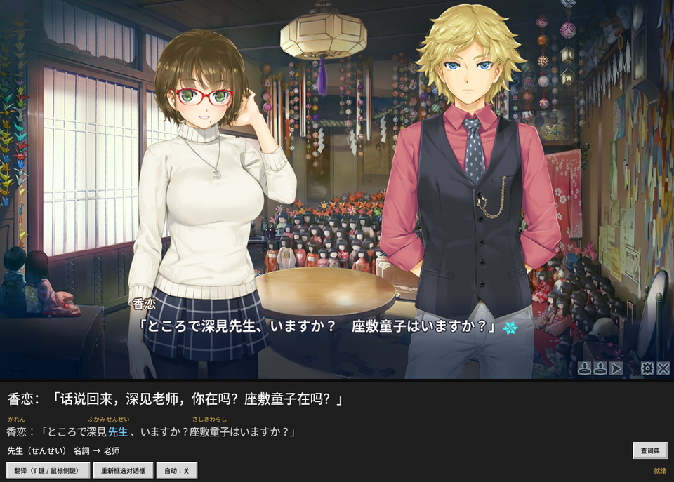
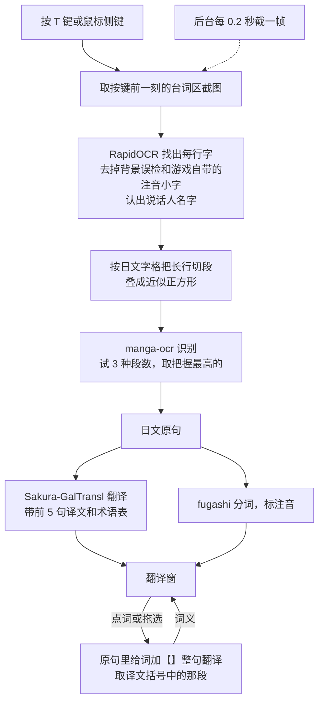

# galgame-ocr-translator

给 Linux + Wine 下玩的日文视觉小说配一个外挂翻译窗：按一下键，截取游戏台词区，识别日文，用本地大模型翻成中文。全部离线，在一张 RTX 3090 上每句一两秒。



第一次用之前，在仓库根目录建一个 `config.json`，写上游戏窗口标题里的一段文字，程序靠它找到游戏窗口：

```json
{"game_title": "游戏窗口标题里的一段文字"}
```

然后在翻译窗里点「重新框选对话框」，框出台词区。默认台词区和 16:9 画面比例是按台词直接写在画面中下部的游戏调的，画面比例不同就改 `vn_translate.py` 里的 `GAME_ASPECT`。

## 背景

大多数在日本发售的正版 galgame 只有日文版。民间汉化只覆盖少数热门作品，往往要等很久，而且补丁要改动游戏文件。这样一来，买了正版，不懂日语的人读不了，懂一点日语的人读得慢，生词要一个个切出去查词典。常见的取文本工具（Textractor 等）是 Windows 程序，要注入游戏进程。

这个工具只看屏幕。截图、识别、翻译都在本机完成，不改游戏文件，不碰游戏进程，正版游戏原样安装，在 Linux + Wine 下也能用。它也不想替代原文：日文原句一直留在窗口里，带注音，点词就能查意思。日语够用的人可以照常读原文，只在卡住的句子上看一眼中文，顺便学到生词。

## 功能

- **翻译**：游戏在前台时按 `T`，或按鼠标侧键（后退/前进）。也可以开「自动」，台词一变就翻。不用中键，因为不少游戏按中键会隐藏台词。
- **注音**：日文原句每个汉字上方标平假名。
- **查词**：单击一个词，显示原形、读音、词性和它在这句里的中文意思，同时复制到剪贴板。按住拖过几个词，按词组查（気/に/かけ → 気にかける）。「查词典」按钮用浏览器打开词典网页。
- **人名**：台词上方的说话人名字会显示成 `名字：「……」`。

## 流程



1. **截图**：用 python-xlib 找到游戏窗口，去掉黑边，截取台词区。后台每 0.2 秒存一帧，按键时取按键前一刻的画面。
2. **找文字行**：用 RapidOCR 的检测模型找出每行字，然后：
   - 去掉背景花纹的误检；
   - 去掉游戏自带的注音小字（高度不到正文 0.6 倍、紧贴在正文上方）；
   - 认出单独一行的说话人名字。
3. **识别**：用 manga-ocr 识别。它会把输入图压成正方形，长行会被压坏，所以：
   - 先按日文等宽字格把一行切成几段，叠成近似正方形；
   - 段数试 3 种，取模型把握最高的结果；
   - 关掉 manga-ocr 自带的 `no_repeat_ngram_size=3`。这个设置不允许同样的三个字出现两次，同一行第二次出现「してい」「……」时会被强行改字。
   - 模型看到行首的「，省略号后面的字容易被认成」（「……一寸」认成「……」寸」）。同一行出现「a」b」时，把前一个」换成模型在那个位置的第二候选，从那里往后重新识别。
4. **翻译**：用 Sakura-GalTransl-7B-v3.7（GGUF，llama-cpp-python 跑在 GPU 上），带上前 5 句译文和术语表。
5. **注音与查词**：
   - 分词用 fugashi + unidic-lite。
   - 读错的人名或特殊读法写进读音修正表。
   - 查词时在原句里给选中的词加【】再整句翻译，取译文里括号中的那一段。Sakura 只会翻译，直接问它"这个词什么意思"，它会把问题本身翻掉；单独翻一个词又常常原样照抄（素→素）。

## 安装

需要：
- NVIDIA 显卡（显存约 7 GB）和 conda；
- X11 桌面（Wayland 下截图和全局热键不可用）；
- 日文/中文字体 Noto Sans CJK，Ubuntu 上是 `sudo apt install fonts-noto-cjk`。

python-xlib 和 pynput 是纯 Python 实现，不需要额外的系统库。剪贴板用的是 Tk 自带的，不需要 xclip。

```sh
E=~/envs/vntrans                     # 环境放哪都行,运行时用 VNTRANS_PY 指过去
conda create -y -p $E python=3.11
# tk 必须用 conda-forge 的 xft 版,否则中文显示成方块
conda install -y -p $E -c conda-forge "tk=8.6.13=xft*"
$E/bin/pip install torch --index-url https://download.pytorch.org/whl/cu124
$E/bin/pip install manga-ocr rapidocr_onnxruntime pynput python-xlib   # 会一并装上 fugashi、unidic-lite、jaconv
$E/bin/pip install --only-binary llama-cpp-python llama-cpp-python \
    --extra-index-url https://abetlen.github.io/llama-cpp-python/whl/cu124
```

模型约 6.3 GB，放到仓库根目录的 `models/` 下。程序按 `vn_translate.py` 自己所在的目录找模型，跟从哪个目录启动无关。

```sh
git clone https://github.com/LiYun0607/galgame-ocr-translator.git && cd galgame-ocr-translator
mkdir -p models
wget -P models https://huggingface.co/SakuraLLM/Sakura-GalTransl-7B-v3.7/resolve/main/Sakura-Galtransl-7B-v3.7.gguf
```

manga-ocr 第一次运行时会自动下载自己的模型（约 450 MB）。

开发时用的版本：Ubuntu 22.04、Python 3.11、torch 2.6.0+cu124、llama-cpp-python 0.3.36、manga-ocr 0.1.16、rapidocr-onnxruntime 1.4.4。

## 运行

```sh
VNTRANS_PY=$E/bin/python scripts/vn-translate.sh
```

`VNTRANS_PY` 是装好依赖的 Python。脚本可以从任何目录调用，也可以软链接到 `~/.local/bin` 里。脚本会清掉 `PYTHONPATH`，免得系统里的 ROS 等包混进来。

`scripts/wine-launch.sh <游戏目录> <exe 文件名>` 是用 Wine 启动游戏的脚本，做三件事：
- 设日文 locale；
- 加大声音缓冲，CPU 忙时耳机里不会噼啪响；
- 退出后重新打开 GNOME 夜灯，因为 Wine 退出时会把显示器颜色曲线重置。

## 配置

`config.json` 放在程序目录，关闭窗口时会自动写回：

| 字段 | 作用 |
|---|---|
| `game_title` | 游戏窗口标题里的一段文字，必填 |
| `region` | 台词区占游戏画面的比例 [左, 上, 右, 下]，用「重新框选对话框」改 |
| `glossary` | 术语表，每条 `日文->中文 #备注`，整句翻译和查词都会参考。和中文同形但意思不同的词（辟易、香具師）放这里 |
| `readings` | 读音修正表，分词器读错的人名、特殊读法写这里 |
| `trigger_key` / `trigger_buttons` | 触发键 |
| `dict_url` | 「查词典」打开的网址，`{word}` 处填词 |

术语表和读音表会和代码里的默认值合并。

## 排查

每次翻译都会把截图和识别结果覆盖保存为 `last_capture.png` / `last_capture.txt`。认错字时先看这两个文件。

## 用到的模型和库

| 用途 | 模型 / 库 | 许可 |
|---|---|---|
| 翻译 | [Sakura-GalTransl-7B-v3.7](https://huggingface.co/SakuraLLM/Sakura-GalTransl-7B-v3.7)（GGUF Q6_K），[SakuraLLM](https://github.com/SakuraLLM/SakuraLLM) 和 [GalTransl](https://github.com/xd2333/GalTransl) 两个项目合作训练。基于 [Sakura-7B-Qwen2.5-v1.0](https://huggingface.co/SakuraLLM/Sakura-7B-Qwen2.5-v1.0) 用 GRPO 强化，最底层是 [Qwen2.5-7B](https://huggingface.co/Qwen/Qwen2.5-7B) | CC BY-NC-SA 4.0 |
| 运行翻译模型 | [llama-cpp-python](https://github.com/abetlen/llama-cpp-python)（[llama.cpp](https://github.com/ggml-org/llama.cpp) 的 Python 绑定） | MIT |
| 找文字行 | [RapidOCR](https://github.com/RapidAI/RapidOCR)（onnxruntime 版），只用其中的检测模型 PP-OCRv4 det，出自 [PaddleOCR](https://github.com/PaddlePaddle/PaddleOCR) | Apache-2.0 |
| 识别日文 | [manga-ocr](https://github.com/kha-white/manga-ocr)，模型 [kha-white/manga-ocr-base](https://huggingface.co/kha-white/manga-ocr-base) | Apache-2.0 |
| 分词与读音 | [fugashi](https://github.com/polm/fugashi)（MeCab 的 Python 封装）+ [unidic-lite](https://github.com/polm/unidic-lite) 词典 | MIT（UniDic 词典本身是 BSD） |

## 许可

本仓库的代码采用 [MIT](LICENSE) 许可。翻译模型 Sakura-GalTransl 采用 CC BY-NC-SA 4.0，仅限非商业使用。本仓库不包含模型和游戏文件。效果图里的游戏画面版权归原作者所有，仅用来展示效果。
